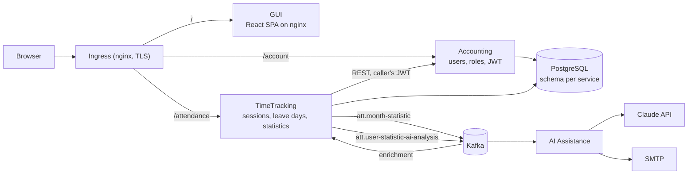

# Attendance Platform

A multi-tenant employee time-tracking system built as Spring Boot microservices on Kubernetes.
Companies sign up, administrators manage their employees, employees clock in and out and record leave
days, and administrators get monthly statistics — optionally with an AI-written trend analysis that is
emailed to them.

This repository is the entry point: it holds the shared infrastructure (Helm platform chart, Docker
Compose stack, cluster scripts, SQL) and this overview. Each service lives in its own repository.

## Architecture



**How a monthly report travels through the system**

1. An administrator asks TimeTracking for a month's statistics with `report=true`.
2. TimeTracking computes worked days, hours, overtime, vacation and sick days per employee, stores them,
   and looks up the requester's and employees' names in Accounting, forwarding the caller's JWT.
3. It publishes one `MonthStatisticEvent` per employee to Kafka, keyed by user id.
4. Its own enrichment consumer adds up to six previous months of history and publishes a
   `UserStatisticAnalysisRequestEvent`.
5. The AI service turns that history into a prompt, asks Claude for a short trend analysis, and emails it
   as HTML to the administrator who asked.

The whole chain carries one trace id, from the HTTP request to the email.

## Repositories

| Repository | Role |
| --- | --- |
| [attendance-project-common](https://github.com/nikolaev13nik/attendance-project-common) | This repo: platform Helm chart (namespace, Postgres, Kafka, Ingress), Docker Compose stack, GKE scripts, Argo CD applications, docs |
| [Attendance-Accounting](https://github.com/nikolaev13nik/Attendance-Accounting) | Organizations, users and roles; login and JWT issuing |
| [Attendance-TimeTracking](https://github.com/nikolaev13nik/Attendance-TimeTracking) | Work sessions, leave days, monthly statistics, Kafka producer and enrichment consumer |
| [Attendance-AI-Assistance](https://github.com/nikolaev13nik/Attendance-AI-Assistance) | Kafka consumer that asks Claude for an analysis and emails it |
| [Attendance-Gui-App](https://github.com/nikolaev13nik/Attendance-Gui-App) | React single-page app in English, Hebrew and Russian |
| [attendance-common-lib](https://github.com/nikolaev13nik/attendance-common-lib) | Shared Spring Boot auto-configuration for security and logging, published to GitHub Packages |

## Design decisions

**Multi-tenancy in the URL.** Every secured endpoint carries `{tenantId}` in its path. A shared
`TenantInterceptor` compares it with the `tenantId` claim in the JWT and answers 403 on a mismatch, and it
fails closed on a tenant URL with no tenant in it. User ids are unique per company: the users table has the
composite key `(tenant_id, id_user)`.

**Roles and the platform administrator.** Roles form a hierarchy: `PLATFORM_ADMIN` > `ADMINISTRATOR` >
`USER`. The platform administrator is that role *and* home tenant 0 in the token; only that account may act
inside any company, and no API can grant the role. Endpoints declare access with `@AdminOnly`,
`@AdminOrSelf` and `@PlatformAdminOnly` from the shared library.

**One JWT issuer.** Accounting issues HS256 tokens carrying the user, roles and tenant; TimeTracking
validates them as an OAuth2 resource server. When TimeTracking calls Accounting it forwards the caller's
own token, so Accounting applies the same permissions.

**A pipeline per endpoint.** In Accounting and TimeTracking each endpoint is one strategy service that
runs `fetch → validate → executeBusiness → persist → mapResult` over a context object. The base class owns
the transaction and writes one log line per call: completed, rejected (4xx, at WARN) or failed (ERROR).

**Contract first.** REST APIs and Kafka events are both described in OpenAPI files; controllers'
interfaces, DTOs and the TimeTracking → Accounting client are generated from them at build time.

**Messaging that fails safely.** Spring Cloud Stream on Kafka, messages keyed by user id, a dead-letter
topic per consumer, and validation errors marked non-retryable so a malformed message goes straight to
the DLQ instead of being retried.

**Observability.** Micrometer Tracing puts a `traceId` on every log line and propagates it over HTTP and
Kafka (W3C `traceparent`). Each line also carries the caller, tenant and target user; names and emails are
kept out of logs. Logs are plain text locally and JSON on GKE.

**Schema under version control.** Flyway owns both schemas and Hibernate only validates them. Tests run
the same migrations on H2 in PostgreSQL mode, with test data in separate migrations.

**An AI client that cannot surprise the bill.** The AI service uses a free stub unless a provider is
configured, so tests and local runs never call the paid API. The Anthropic client (Claude Sonnet 5.5)
separates temporary failures (retried) from permanent ones such as a bad key (sent to the DLQ), and keeps
a small in-memory cache so a retry after a failed email does not pay for the same analysis twice.

**Protected sign-up.** Public sign-up is guarded by a Cloudflare Turnstile captcha verified server-side
and by a rate limit on the ingress.

## Tech stack

| Area | Tools |
| --- | --- |
| Backend | Java 17, Spring Boot 4, Spring Security (OAuth2 resource server, JWT), Spring Data JPA, Flyway, MapStruct, Lombok |
| Messaging | Apache Kafka, Spring Cloud Stream |
| AI and mail | Anthropic Java SDK (Claude), Spring Mail |
| Data | PostgreSQL; H2 for tests |
| Frontend | React 18, React Router 7, Vite 7, Vitest |
| Contracts | OpenAPI Generator |
| Observability | Micrometer Tracing (Brave), structured JSON logging |
| Delivery | Docker, Helm, Kubernetes (GKE and k3s), Argo CD, cert-manager with Let's Encrypt, GitHub Actions, GitHub Container Registry, GitHub Packages |

## Running it locally

The Compose stack builds every service from its sibling folder, so clone all repositories side by side:

```
IdeaProjects/
├── attendance-project-common
├── Attendance-Accounting
├── Attendance-TimeTracking
├── Attendance-AI-Assistance
└── Attendance-Gui-App
```

Then:

```bash
cd attendance-project-common
cp .env.example .env          # fill in the passwords and the JWT secret
docker compose up --build
```

The GUI is served on http://localhost:8080. The Java builds download `attendance-common-lib` from GitHub
Packages, which needs a GitHub token with `read:packages` under server id `github` in
`~/.m2/settings.xml`; Compose passes that file to the build as a secret.

For Kubernetes, the same stack runs on k3s (Rancher Desktop) with `helm/platform/values-local.yaml`.
[sharedFiles/DEPLOYMENT-GUIDE.md](sharedFiles/DEPLOYMENT-GUIDE.md) walks through Compose, plain manifests
and Helm step by step.

## Deployment and CI

- **Production** runs on Google Kubernetes Engine (zone `me-west1-a`, Tel Aviv): the platform chart from
  this repo plus one Helm chart per service, TLS from cert-manager and Let's Encrypt.
  `scripts/gcp-start.sh`, `gcp-stop.sh` and `gcp-status.sh` start, stop and inspect the cluster.
- **Locally**, Argo CD watches each service's chart on `main` and syncs it to the k3s cluster with pruning
  and self-healing.
- **CI** (GitHub Actions, per service): build, tests and a JaCoCo gate of 85% line coverage, then a Docker
  image pushed to GitHub Container Registry, a version tag, and the new version written into the chart.

## Tests

| Component | Tests |
| --- | --- |
| Accounting | 104 |
| TimeTracking | 99 |
| AI Assistance | 59 |
| attendance-common-lib | 41 |
| GUI | 32 |

The Spring services are tested end to end through their HTTP APIs against migrated H2 schemas; external
systems (Accounting from TimeTracking, SMTP, the Claude API) are mocked or stubbed.

## Not implemented yet / future development

These are planned in the original design and are **not built yet**:

- **Nightly conflict detection:** a scheduler that finds broken clock records from the previous day and
  publishes them per tenant for the AI service to suggest fixes.
- **Monthly aggregation scheduler:** computing every employee's statistics automatically on the first
  night of the month, instead of only on request.
- **AI suggestions for conflicts** and notifications to employees; today the AI service only analyses
  monthly trends for the administrator who asked.
- **DLQ monitoring and alerting:** dead-letter topics exist, but nothing watches them yet.
- **Asymmetric JWT signing** (RS256), so that only Accounting holds the signing key.
- **Argo CD on GKE:** production is deployed with Helm today; GitOps runs on the local cluster only.

## More documentation

- [helm/platform/README.md](helm/platform/README.md) — the platform chart and the names services rely on
- [sharedFiles/DEPLOYMENT-GUIDE.md](sharedFiles/DEPLOYMENT-GUIDE.md) — Compose → Kubernetes → Helm
- [docs/manual-testing.md](docs/manual-testing.md) — driving the APIs by hand with Postman
- [docs/seeding-test-data.md](docs/seeding-test-data.md) — generating attendance data for the statistics
